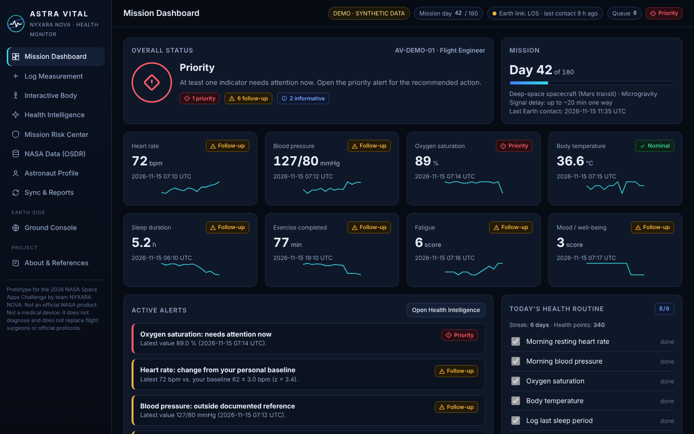

# ASTRA VITAL — Intelligent Astronaut Health Monitoring System

**Team NYXARA NOVA · NASA Space Apps Challenge 2026 · Trujillo, Peru**
Challenge: *Create Health Monitoring Software for Astronauts on Space Missions*
*We control the unseen.*

**Live app:** https://etner249.github.io/astra-vital/ · **30 s demo:** https://youtu.be/lxITVao2RmQ · **Full presentation:** https://youtu.be/sz9qzXasEKc
**Version submitted to NASA (15/11/2026, unchanged):** https://etner249.github.io/astra-vital/nasa-2026/ · branch `backup/nasa-submission-2026-11-15` (commit `8df773b`)

## Evaluator access (academic edition)
The main URL opens **NASA Evaluator Access**: sign in with one of the three public demo accounts (shown on the page, served by the backend):

| Role | Email | Password | Can do |
|---|---|---|---|
| Administrator | `admin.demo@astravital.example` | `AstraDemo-Admin-2026` | Everything; user management read-only |
| Doctor / Specialist | `medico.demo@astravital.example` | `AstraDemo-Medico-2026` | Log/edit measurements, review alerts, reports |
| Operator | `operador.demo@astravital.example` | `AstraDemo-Operador-2026` | View modules, log measurements |

1. Open https://etner249.github.io/astra-vital/ (the free Render backend may take up to ~50 s to wake up).
2. Click **Usar esta cuenta** on a role, then **Ingresar**.
3. Use the ten original modules; Mission Control (Crew & Missions, Measurements Database, Alert Review, Users, Audit) appears according to the role.

> Public demo accounts — do not enter personal, medical or real data. All astronaut data is synthetic and the database is reset when the free Render instance restarts.

> Independent student prototype. **Not an official NASA product. Not a medical device** — it does not diagnose and does not replace flight surgeons or official protocols.

ASTRA VITAL helps astronauts on long-duration missions log health indicators, compare them with documented references and with their own baseline, understand how they relate to NASA's five hazards of human spaceflight, and know what to do and when to involve the medical team, even with no link to Earth.



## Features
| Module | What it does |
|---|---|
| Mission Dashboard | Overall status, latest indicators with sparklines, active alerts, mission day, environment and signal delay, time since Earth contact, sync queue, daily health routine (streaks + points) |
| Log Measurement | Validated entry with unit, time, source, notes; "how to measure" guidance |
| Interactive Body | Clickable cardiovascular, musculoskeletal, nervous/behavioral, immune, general systems; color + icon + text status; trends, baselines, hazards |
| Health Intelligence | Explainable rule engine: data quality, missing data, documented references, personal baseline (≥2 SD), 7-day trend; consolidated alerts with what/why/action/contact + source |
| Mission Risk Center | NASA's five hazards (RIDGE) with risks, indicators, preventive measures and limitations; environment selector |
| NASA Data (OSDR) | Real Inspiration4 lab data (OSD-575, OSD-569) with lab reference ranges and quality checks |
| Sync & Reports | Offline-first queue, AOS/LOS, batch transfer, versioning + conflicts, recovery after link drop; PDF/HTML report, CSV, JSON backup/restore |
| Ground Console | Flight-surgeon view of synchronized data only; notes delivered to crew at next sync |

## Videos and brand
- `video/final/ASTRA_VITAL_NASA_DEMO_30S.mp4` (29.6 s, official demo) and `ASTRA_VITAL_EXTENDED_PRESENTATION.mp4` (106.5 s); English subtitles burned in, plus `_NO_SUBS` versions and SRT files in `video/subtitles/`.
- Narration: AI-generated female voice (Kokoro-82M, local). Details: `docs/VIDEO_PRODUCTION_REPORT.md`, `docs/AI_DISCLOSURE.md`.
- Brand: `assets/brand/` (original symbol, logos, favicon) and `docs/BRAND_GUIDELINES.md`.

## Data honesty
- **Real:** NASA OSDR OSD-575 (`LSDS-8_Comprehensive_Metabolic_Panel_CMP_TRANSFORMED.csv`) and OSD-569 (`LSDS-7_Complete_Blood_Count_CBC_TRANSFORMED.csv`), Inspiration4, 4 civilian crew, timepoints L-92 … R+194. Subset in `data/osdr_i4_subset.csv` (values unchanged).
- **Synthetic:** all crew vital signs in the demo are generated by a seeded algorithm (`demoRecords()` in `src/app.js`) and labeled "synthetic" everywhere. Scenario: declining sleep, rising fatigue and heart rate, sustained stage-1 blood pressure, one low SpO2 reading, one missed day, one typing error.
- **References:** see `src/engine.js` → `SOURCES`. Rules marked *engine convention* are engineering choices, not clinical thresholds.

## Architecture
```
src/engine.js   Health Intelligence Engine (pure functions, no DOM) — analyze(), baseline(), checkQuality(), mergeInto()
src/app.js      UI, routing (#hash views), sign-in, API client, offline queue (localStorage), sync to the ground API, reports, SVG charts
src/styles.css  Mission-control dark theme, responsive (desktop/tablet/mobile), print styles for reports
data/           Real OSDR subset (CSV + JSON)
build.py        Inlines everything into index.html / dist/index.html; injects the API URL and a CSP limited to it
nasa-2026/      Byte-identical copy of the version submitted to NASA (never rebuilt)
tests/          engine.test.js (Node) · e2e.py (submitted version) · e2e_academic.py (academic edition, 3 roles, 72 checks)
video/          capture.py (real screen captures) · render.sh (FFmpeg) · subtitles · narration script
```
Why this stack: a single static file is the most reliable thing to demo in a hackathon, runs on any device without installation or internet, is easy for judges to open, and keeps the engine auditable.

## Academic edition: architecture
```
GitHub Pages (etner249.github.io/astra-vital/)        Render (Flask + SQLite)
  index.html  ── HTTPS + JSON, Bearer token ──▶   /api/v1  (repo Etner249/astra-vital-flask-sqlite)
  · login, 10 original modules, Mission Control      · auth/login, logout, me (tokens hashed, 8 h, revocable)
  · offline queue in localStorage (AOS/LOS)          · astronauts, missions, measurements (9 indicators), alerts, users, audit
                                                     · same permission matrix + demo-account limits as the Flask UI
```
- No Flask code runs on GitHub Pages: the page is static; the backend runs on Render.
- **Auth:** Bearer token kept in `sessionStorage` (no cookies → works across sites and CSRF does not apply). 401 returns to the login.
- **CORS:** the API only answers browsers from the exact origin `https://etner249.github.io` (`CORS_ORIGINS`).
- **CSP:** the page can only connect to the configured API origin.
- **Ground store = API:** each record is saved locally first and sent in batches of 5 when the Earth link is AOS; the server validates, stores it in SQLite and generates alerts.
- **Free Render plan:** the instance sleeps (first request ~50 s) and SQLite is recreated with synthetic demo data at every restart/deploy.

## Run
```bash
python3 build.py                 # index.html for Pages, API = https://astra-vital-academic.onrender.com/api/v1
AV_API_BASE=http://127.0.0.1:5056/api/v1 AV_OUT_DIR=/tmp/site/astra-vital python3 build.py   # local build
# backend: see Etner249/astra-vital-flask-sqlite (CORS_ORIGINS=http://127.0.0.1:8080 for local tests)
python3 tests/e2e_academic.py http://127.0.0.1:8080/astra-vital/ /tmp/shots
open dist/index.html             # or any static server
node tests/engine.test.js        # unit tests
pip install playwright && python3 tests/e2e.py   # end-to-end (uses /usr/bin/google-chrome)
```
Deploy: enable GitHub Pages (branch `main`, root) — `index.html` at the repo root is the built app.

## Tests (last run)
- Engine: 10/10 passed. E2E: 27/27 passed, 0 console errors, no overflow at 390 px and 820 px widths.

## AI usage disclosure
The team used an AI assistant (Claude, by Anthropic) to help write code, tests, documentation and to assemble the demo video. Idea, scope and decisions are the team's; health rules and sources were reviewed by the team. No AI model runs inside the app. Video narration is an AI-generated voice and the team emblem is AI-generated (both labeled); see docs/AI_DISCLOSURE.md.

## Limitations
Not a medical device; manual entry only (no sensor integration); the ground server runs on Render's free plan (sleeps when idle, data reset on restart; the submitted version at /nasa-2026/ keeps the original local-only sync); engine conventions need clinical validation; OSDR data: n = 4, 3-day mission — no causal claims.

## Team
Etner Therry Rios Vasquez (owner) · Jeanfranco Alfredo Ibarra Kocfú · Darlin Saldaña Pinedo · Máximo Fabrizzio Espinoza Peche

## License
Code: MIT (see LICENSE). NASA OSDR data: public NASA open data, credited above.
